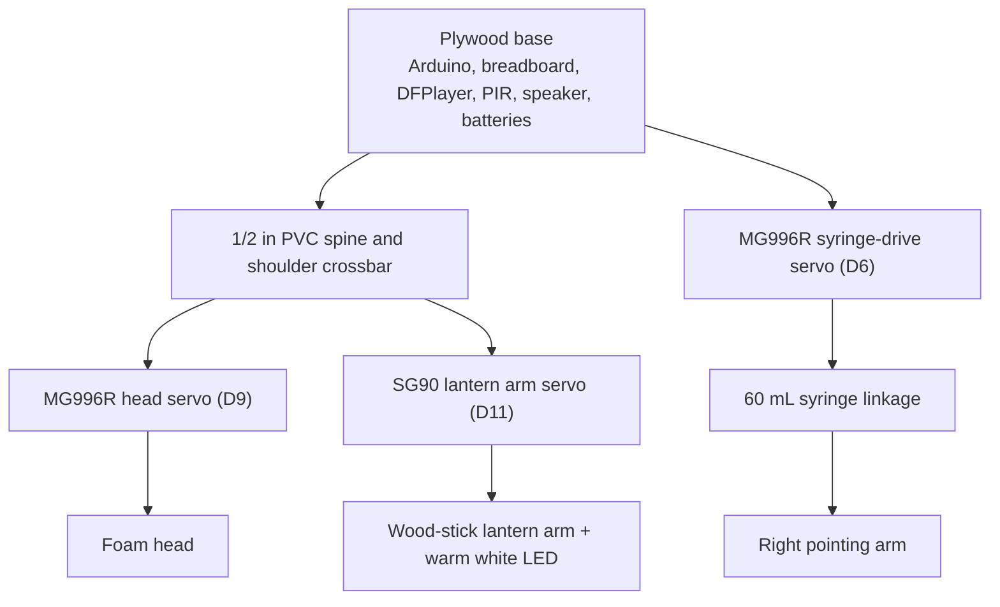
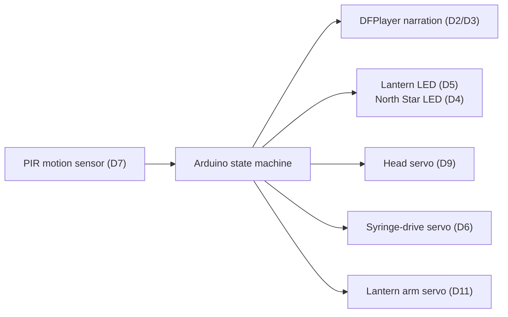

# The North Star - Harriet Tubman Animatronic Exhibit

"The North Star" is a portable Arduino animatronic exhibit built for the 2026 Tennessee TSA Animatronics event. When a viewer approaches, a PIR sensor starts the narration, the head turns, the lantern lights, the right arm moves through a syringe linkage, and the North Star LED turns on.

**Result:** 1st place at the Tennessee TSA State Championship, with a documented score of **127 / 130**.

## System Summary

| Area | Final Build |
| :--- | :--- |
| Controller | Arduino Uno-compatible ATmega328P board |
| Trigger | HC-SR501 PIR motion sensor |
| Audio | DFPlayer Mini with microSD narration file |
| Motion | MG996R head servo, MG996R syringe-drive servo, SG90 lantern arm servo |
| Lighting | Warm white lantern LED, orange/amber North Star LED |
| Arm Drive | 60 mL syringe linkage driven by an MG996R servo |
| Power | 9V battery to Arduino barrel jack, switched 4xAA battery pack for servo rail, shared ground |
| Reliability Fixes | Servo rail capacitor, DFPlayer voltage divider, PIR warm-up protocol, syringe-linkage corrections |

## Behavior

1. The Arduino waits through a 60-second PIR warm-up window after power-on.
2. Motion on the PIR sensor starts the sequence.
3. The DFPlayer plays `/mp3/0001_harriet.mp3`.
4. The lantern LED turns on and the head servo turns toward the viewer.
5. The syringe-drive servo moves the right arm linkage.
6. The North Star LED turns on during the pointing gesture.
7. The servos return home, audio stops, and the system enters a short cooldown.

The firmware avoids blocking timing during the show loop. Servo movement, LEDs, sensor checks, and state transitions are coordinated with `millis()` through a finite state machine.

## System Design

## Repository Map

- [`tsa-north-star-animatronic.ino`](./tsa-north-star-animatronic.ino) - Arduino entry point and pin assignments.
- [`src/StateEngine.cpp`](./src/StateEngine.cpp) - Non-blocking sequence state machine.
- [`src/Actuators.cpp`](./src/Actuators.cpp) - Ramped servo wrapper with safe angle limits.
- [`src/Sensors.cpp`](./src/Sensors.cpp) - PIR debounce handling.
- [`src/AudioController.cpp`](./src/AudioController.cpp) - DFPlayer serial packet interface.
- [`hardware/bom.md`](./hardware/bom.md) - Bill of materials and pin map.
- [`hardware/mechanical_assembly.md`](./hardware/mechanical_assembly.md) - Physical frame and linkage notes.
- [`hardware/schematics/system_schematic_ascii.txt`](./hardware/schematics/system_schematic_ascii.txt) - Text wiring diagram.
- [`docs/assembly_guide.md`](./docs/assembly_guide.md) - Assembly and calibration guide.
- [`docs/postmortem_failure_log.md`](./docs/postmortem_failure_log.md) - Real build failures and fixes.
- [`docs/historical_context.md`](./docs/historical_context.md) - Historical and presentation context.
- [`docs/engineering_notebook.md`](./docs/engineering_notebook.md) - Timeline and team roles.
- [`docs/evidence_summary.md`](./docs/evidence_summary.md) - Private-source evidence summary without personal/order data.

## Build and Upload

1. Open [`tsa-north-star-animatronic.ino`](./tsa-north-star-animatronic.ino) in the Arduino IDE.
2. Select **Arduino Uno** as the board.
3. Install the standard `Servo` library if it is not already installed.
4. Format the microSD card as FAT32.
5. Create a folder named `mp3` on the card.
6. Save the narration as `0001_harriet.mp3` inside that folder.
7. Upload the sketch.
8. Open Serial Monitor at `115200` baud for state transition logs.

## Media Plan

Final photos and demo clips will be added under `docs/assets/`. The useful shots are the completed exhibit, the exposed skeleton, the electronics layout, the syringe linkage, and a short full-sequence demo.
